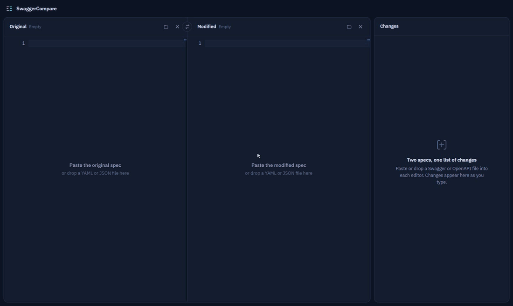
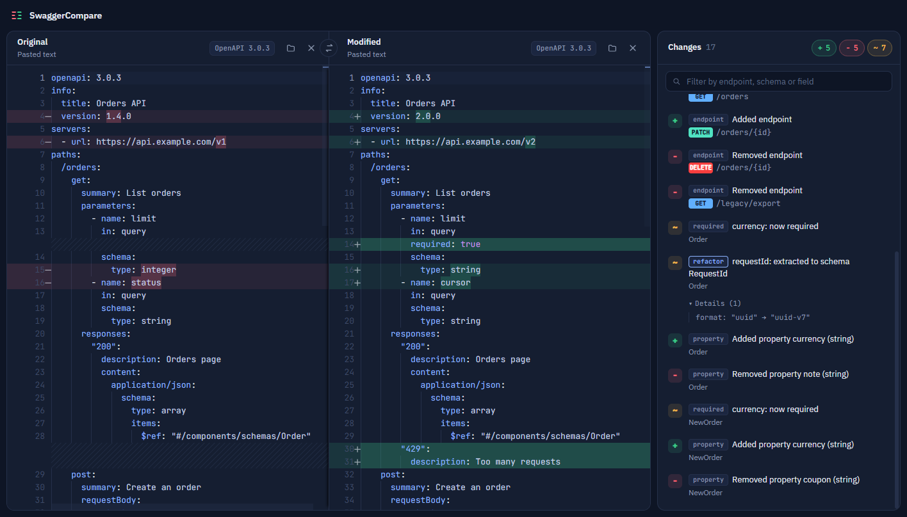

<p align="center"></p>
<h1 align="center">SwaggerCompare</h1>

<p align="center">
  See what changed between two versions of an API spec, in plain words.<br>
  Swagger 2.0 and OpenAPI 3.x, YAML or JSON. Runs on Windows, offline, no install.
</p>

<p align="center">
  <a href="https://github.com/malkowicz3-al/SwaggerCompare/releases/latest/download/SwaggerCompare-web.zip"><b>Download SwaggerCompare-web.zip</b></a>
  &nbsp;·&nbsp;
  <a href="https://github.com/malkowicz3-al/SwaggerCompare/releases/latest">All downloads</a>
</p>

<p align="center">
  
</p>

A text diff of two specs tells you that lines 71 to 76 moved. SwaggerCompare parses both specs and tells you what that means for the API: an endpoint was removed, a query parameter became required, a field was moved into its own schema. Click any change to jump to its line.

## What you get

- **A side-by-side diff** of the two files, as you pasted them. Nothing is reformatted.
- **A change list that updates as you type**, one short line per change with a small tag (endpoint, property, required, pattern…), labelled with the endpoint or schema it belongs to.
- **Changes, not noise.** Reordered keys, YAML vs JSON formatting and reordered parameters don't show up in the change list.
- **Refactors read as one change.** When a field's inline definition is moved into a `$ref`, you see one entry, *"requestId: extracted to schema RequestId"*, with the real differences folded under a "Details" toggle.
- **Filters and search.** Toggle added, removed or changed entries, or search by endpoint, schema, field or tag.
- **Private by design.** Everything runs on your machine. Your specs are never uploaded anywhere.

<p align="center">
  
</p>

## What it recognises

| Area | Examples from the change list |
|---|---|
| Endpoints | `Added endpoint` · `Removed endpoint` (labelled `PATCH /orders/{id}`) |
| Parameters | `Added parameter query 'cursor'` · `limit: now required` · `limit: type integer → string` |
| Responses | `Added response 429` · `Removed response 500` |
| Schemas | `Added schema Order` · `Added property currency (string)` · `Removed property note (string)` |
| Required fields | `currency: now required` · `email: no longer required` |
| `$ref` refactors | `requestId: extracted to schema RequestId` · `requestId: inlined from schema RequestId` |
| Everything else | `version: "1.4.0" → "2.0.0"` · `request body (application/xml) added` |

Nothing is dropped: anything that doesn't match a pattern above still appears as a plain added, removed or changed entry.

## Try it in a minute

1. Download [`SwaggerCompare-web.zip`](https://github.com/malkowicz3-al/SwaggerCompare/releases/latest/download/SwaggerCompare-web.zip) (2 MB), or use **Code → Download ZIP** on this page. Both work the same way.
2. Unzip it and double-click **`SwaggerCompare.bat`**. The app opens in a Microsoft Edge window. Nothing is installed.
3. Drag `examples/orders-api-v1.yaml` onto the left pane and `examples/orders-api-v2.yaml` onto the right one, or paste your own specs.

If Windows asks whether to run the `.bat`, choose **Run**. To skip the prompt, right-click the zip → **Properties** → **Unblock** before unzipping. If `.bat` files are blocked on your machine, open `src\index.html` in Edge or Chrome instead.

**Prefer a standalone app?** Download `SwaggerCompare-win.zip` from the [releases](https://github.com/malkowicz3-al/SwaggerCompare/releases/latest), unzip, and run `SwaggerCompare.exe`. It is unsigned, so SmartScreen may warn: **More info** → **Run anyway**.

## Development

```
npm install
node node_modules/electron/install.js   # once, if npm blocked Electron's install script
npm start      # build and run the Electron app
npm test       # run tests
npm run dist   # build dist/SwaggerCompare-win.zip and dist/SwaggerCompare-web.zip (Windows only)
```

`npm run build` regenerates `src/gen/renderer.js` (esbuild bundle) and `vendor/` (Monaco and fonts copied from node_modules). Both are committed so the repo itself runs from `SwaggerCompare.bat`: run `npm run build` and commit them after changing `src/`. A test fails if the committed bundle is out of date.

How it works inside: [docs/ARCHITECTURE.md](docs/ARCHITECTURE.md).

Built with [Monaco Editor](https://github.com/microsoft/monaco-editor) and [yaml](https://github.com/eemeli/yaml). Fonts: IBM Plex Sans and JetBrains Mono (SIL Open Font License, see `vendor/fonts`).
