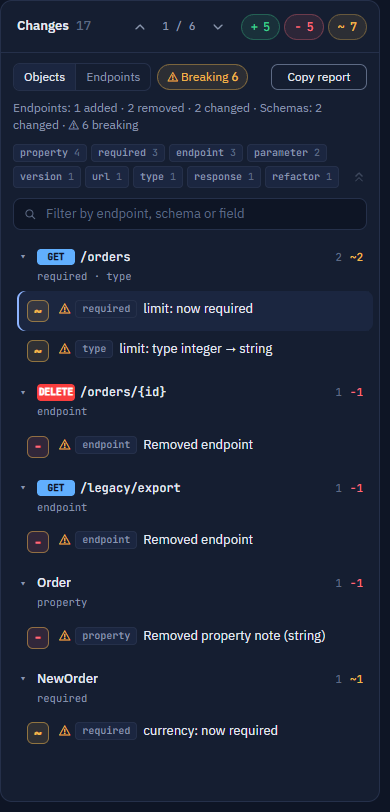
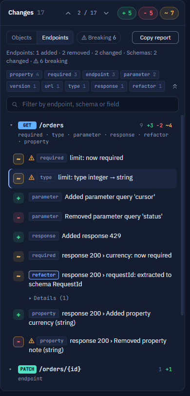
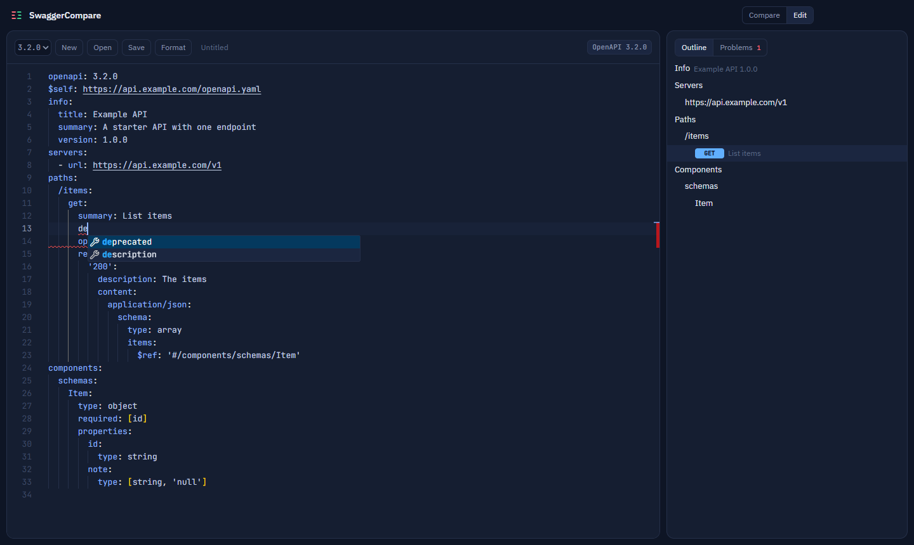

<p align="center"></p>
<h1 align="center">SwaggerCompare</h1>

<p align="center">
  What changed between two versions of your API, and what will it break?<br>
  Swagger 2.0 and OpenAPI 3.x, YAML or JSON. Windows, offline, nothing to install.<br>
  Plus an OpenAPI 3.x editor with completion, live problems and an outline.
</p>

<p align="center">
  <a href="https://github.com/malkowicz3-al/SwaggerCompare/releases/latest/download/SwaggerCompare-web.zip"><b>Download SwaggerCompare-web.zip</b></a>
  &nbsp;·&nbsp;
  <a href="https://github.com/malkowicz3-al/SwaggerCompare/releases/latest">All downloads</a>
</p>

<p align="center">
  
</p>

## Why it exists

A new version of an API spec lands: from another team, a vendor or your own backend. Before anyone writes code, somebody has to answer:

- **What changed?** Which endpoints, parameters, responses and fields.
- **What breaks?** Which changes will make today's clients fail.
- **Where does it hit?** Which endpoints a changed schema reaches, even through nested `$ref`s.
- **How much work is it?** How many changes, how big, and what has to be updated.

A text diff can't answer that. It shows that lines 71 to 76 moved, flags reordered keys and YAML/JSON formatting, and turns a field moved into its own schema into a wall of red and green. SwaggerCompare parses both specs and lists the changes in API terms: *"Removed endpoint DELETE /orders/{id}"*, *"limit: now required"*, *"requestId: extracted to schema RequestId"*. Click a change and the fragment lights up in both specs.

## Who it's for

The tool always compares two versions of the same API, so it fits anyone who sits between versions:

| You are | You use it to |
|---|---|
| **Frontend, mobile or integration developer** consuming the API | See which calls and models to update, and which endpoints you use are affected |
| **Backend developer** publishing the API | Check before a release that nothing breaks clients by accident |
| **QA / tester** | Know what to retest and which endpoints changed behaviour |
| **Analyst, product owner, tech lead** | Estimate the work and judge the risk of an upgrade without reading YAML |
| **Tech writer / release manager** | Get a ready list of changes for release notes or a ticket |

Your specs never leave your machine: no server, no upload, no account. It works on internal and confidential APIs and without internet access.

## What you get

<p align="center">
  
</p>

**Answers at a glance**
- **Title, versions and a summary.** The title bar shows *"Orders API 1.4.0 → 2.0.0"*, each pane shows its spec's title and version, and the list opens with *"Endpoints: 1 added · 2 removed · 2 changed · Schemas: 2 changed · ⚠ 6 breaking"*.
- **Breaking changes marked with ⚠.** For example: a removed endpoint or response code, a type change, a new required parameter, a field that became required in a request (or optional in a response), a narrowed enum. The **⚠ Breaking** chip shows only those.
- **Grouped by object.** Changes are grouped per endpoint or schema. Each group shows its count (+ added, − removed, ~ changed) and its tags (property, required, type…), so the big spots stand out. Groups start collapsed; one button opens or closes them all.
- **Which endpoints are hit.** Switch from **Objects** to **Endpoints** to see every change under each endpoint it affects, followed through nested `$ref`s (*"response 200 › currency: now required"*). Changes that hit no endpoint go to "Other".
- **Copy report.** One button copies a Markdown report with the title, the summary, the breaking changes, then the changes per endpoint. It is ready to paste into Jira, Confluence, a PR or release notes.

<p align="center">
  
  &nbsp;&nbsp;
  
</p>

**Changes, not noise**
- **Only real changes.** Reordered keys, YAML vs JSON formatting and reordered parameters are not listed.
- **Refactors read as one change.** A field's inline definition moved into a `$ref` gives one entry, *"requestId: extracted to schema RequestId"*, with the real differences folded under "Details". The same goes for `allOf` / `oneOf` / `anyOf`: moving shared fields into `allOf: [$ref Entity, …]`, flattening it back or turning a schema into a `oneOf`.

**Moving around**
- **Click to highlight.** A change lights up its fragment in both specs, and the property or parameter name flashes briefly.
- **Jump from change to change.** F8 / Shift+F8 or the arrow buttons step through the changes, with a "3 / 17" counter.
- **Filters and search.** Toggle added, removed or changed entries, pick tags in the tag bar (property **4**, required **3**…), or search by endpoint, schema, field or tag.
- **Edit live.** Paste, drop or open files on either side, swap them, or edit the text. The list updates as you type.

**Writing a spec**
- **Edit mode.** The **Compare | Edit** toggle in the title bar opens an OpenAPI 3.x editor with completion, hover docs, live problems and an outline. See [Edit mode](#edit-mode).

## What it recognises

| Area | Examples from the change list |
|---|---|
| Endpoints | `Added endpoint` · `Removed endpoint` (labelled `PATCH /orders/{id}`) |
| Parameters | `Added parameter query 'cursor'` · `limit: now required` · `limit: type integer → string` |
| Responses | `Added response 429` · `Removed response 500` |
| Schemas | `Added schema Order` · `Added property currency (string)` · `Removed property note (string)` |
| Required fields | `currency: now required` · `email: no longer required` |
| `$ref` refactors | `requestId: extracted to schema RequestId` · `requestId: inlined from schema RequestId` |
| `allOf` / `oneOf` refactors | `Order: now allOf [schema Entity + inline]` · `Pet: now oneOf [schema Dog, schema Cat]` · `Order: allOf flattened` |
| Breaking (⚠) | `Removed endpoint` · `Removed response 404` · `limit: type integer → string` · a retargeted `$ref` · `Added parameter query 'q'` (required) · a required request body added · `request body (application/xml) removed` · `currency: now required` (in a request) · `Removed property note` (in a response) · an enum value removed (in a request) or added (in a response) · a tighter `maxLength`, `minimum`, `pattern`… (in a request) |
| Everything else | `version: "1.4.0" → "2.0.0"` · `request body (application/xml) added` |

Nothing is dropped: anything that doesn't match a pattern above still appears as a plain added, removed or changed entry.

**Limits worth knowing**
- **Breaking is a heuristic.** A change is marked when it can break an existing client, judged by where the changed spot is used (request or response).
- **Never marked as breaking:** changes in unused schemas, `info`, `servers`, examples, defaults and `x-` extensions.
- **Not judged yet:** `security` and `basePath` changes.
- **Each spec is compared on its own.** `$ref`s to other files are listed but not followed.

## Edit mode

Switch the title bar toggle to **Edit** to write or fix a single OpenAPI spec. The editor knows OpenAPI 3.0, 3.1 and 3.2 and follows the document's `openapi:` version. A document without one gets 3.2.

<p align="center">
  
</p>

- **Completion (Ctrl+Space, or as you type).** Suggests the keys allowed at the cursor, with required ones first and keys already present left out. It also suggests values: enums such as `in:` and `type:`, `true`/`false`, `openapi:` versions, status codes under `responses` and media types under `content`.
- **`$ref` completion.** After `$ref:` it lists the components of the kind that fits the spot, for example only `#/components/parameters/…` in a parameter list. You can type part of the name, without the `#/components/…` prefix. `$ref` itself is suggested as a key wherever a reference is allowed.
- **Go to definition.** Ctrl+click a `$ref` value, or press F12 on it, to jump to its target. Hover over a `$ref` to see a summary: a schema's title, description, type and first properties, or a parameter's `in` and `required`.
- **Snippets (YAML).** Suggested next to the keys: `path` under `paths`, `operation` in a path (only methods not used yet), `response` under `responses`, `schema` under `components.schemas`, and `parameter: query`, `parameter: path` and `parameter: header` in a parameter list. Tab moves between the placeholders.
- **Hover.** Point at a key to see what it is, its type, whether it is required, and since which version it exists.
- **Live problems.** YAML/JSON syntax errors, a missing or unsupported `openapi` version, unknown keys, wrong types, invalid enum values and missing required fields are underlined and listed under **Problems**, with a count on the tab. Click a problem to jump to it. These checks also run:
  - **errors:** a `$ref` that points nowhere, a path parameter that is missing, not `required: true` or not in the path, a duplicate parameter in one list, a duplicate `operationId`, a security scheme that is not defined, and a server variable `{x}` without `variables.x`;
  - **warnings:** a `$ref` to the wrong kind of component, such as a schema used as a parameter;
  - **notes (info):** a component that nothing uses, and an operation tag missing from the top-level `tags` list (only when that list exists). Notes are not counted on the tab.
- **Compare with…** opens Compare mode with the version as opened or last saved on the left and the current text on the right. If nothing changed since then, only the right side is replaced. Ctrl+Z in a pane brings back what was there.
- **Version-aware.** A key from another version is flagged: `nullable` was removed in 3.1, `webhooks` needs 3.1. 3.1 adds `webhooks`, `jsonSchemaDialect`, `type` lists with `null` and the JSON Schema keywords (`const`, `examples`, `$defs`, `prefixItems`…). 3.2 adds the `query` method and `additionalOperations`, `in: querystring`, `itemSchema`, tag `summary`/`parent`/`kind`, `$self`, `components.mediaTypes` and the OAuth device flow.
- **Outline.** Info, servers, paths with their methods, webhooks, components and tags. Click to jump; the node at the cursor is highlighted.
- **New / Open / Save / Format.** New starts from a small valid template for the chosen version (it asks first if you have unsaved changes). Open takes a file (or drop one on the editor). Save downloads the spec. Format reindents YAML with 2 spaces or pretty-prints JSON; it refuses while the document has syntax errors. Ctrl+Z undoes each of them.
- **Your draft stays.** The text is kept in the browser's local storage and comes back next time, together with the last mode.

**Limits.** Completion reads YAML by indentation, so flow style (`{a: 1}`) and multi-line scalars get no suggestions. `$ref`s to other files are ignored: they are not followed, checked or offered. There are no snippets in JSON. Swagger 2.0 can be compared but not edited.

## Try it in a minute

**You need:** Windows 10 or 11 with Microsoft Edge (built in) or Google Chrome. No Node.js, no npm, no admin rights, no internet.

1. Download [`SwaggerCompare-web.zip`](https://github.com/malkowicz3-al/SwaggerCompare/releases/latest/download/SwaggerCompare-web.zip) (2 MB), or use **Code → Download ZIP** on this page. Both work the same way.
2. Right-click the zip, choose **Extract All…**, open the extracted folder and double-click **`SwaggerCompare.bat`**. The app opens in its own Edge window.
3. Drag `examples/orders-api-v1.yaml` onto the left pane and `examples/orders-api-v2.yaml` onto the right one, or paste your own specs.

If something is missing, `SwaggerCompare.bat` says what and how to fix it:

| Message | Cause and fix |
|---|---|
| *"cannot start: the file … is missing"* | The .bat was started from inside the zip or copied alone. Extract the whole zip and run it from the extracted folder. |
| *"Microsoft Edge or Google Chrome was not found"* | The app opens in your default browser instead. If the page stays empty, install Edge or Chrome, or use `SwaggerCompare.exe`. |
| Windows asks whether to run the `.bat` | Choose **Run**. To skip the prompt, right-click the zip → **Properties** → **Unblock** before extracting. |

If `.bat` files are blocked on your machine, open `src\index.html` in Edge or Chrome.

## Host it on a web server

The app is plain static files with no server-side code, so it runs from nginx, Apache, IIS or any static host. Your team can then open it from a URL without downloading anything.

1. Unzip `SwaggerCompare-web.zip` into the web root, or into any sub-folder of it.
2. Open `https://your-server/`, or `https://your-server/sub-folder/`. The `index.html` at the top opens the app.

The server needs no rules, rewrites or configuration; any static file server works. Specs are still processed only in the browser and never sent to the server. The files under `vendor/` stay the same for a given version and can be cached for a long time; `src/` should not be cached long, so an upgrade shows up at once.

**Prefer a standalone app?** Download `SwaggerCompare-win.zip` from the [releases](https://github.com/malkowicz3-al/SwaggerCompare/releases/latest), unzip it and run `SwaggerCompare.exe`. It is unsigned, so SmartScreen may warn: choose **More info** → **Run anyway**.

## Development

Only needed to change the app, not to use it. You need [Node.js](https://nodejs.org) LTS.

```
npm install
node node_modules/electron/install.js   # once, if npm blocked Electron's install script
npm start      # build and run the Electron app
npm test       # run tests
npm run dist   # build dist/SwaggerCompare-win.zip and dist/SwaggerCompare-web.zip (Windows only)
```

`npm run build` regenerates `src/gen/renderer.js` (an esbuild bundle) and `vendor/` (Monaco and fonts copied from node_modules). Both are committed so the repo runs from `SwaggerCompare.bat` without Node. After changing `src/`, run `npm run build` and commit the result; a test fails if the committed bundle is out of date.

How it works inside: [docs/ARCHITECTURE.md](docs/ARCHITECTURE.md).

Built with [Monaco Editor](https://github.com/microsoft/monaco-editor) and [yaml](https://github.com/eemeli/yaml). Fonts: IBM Plex Sans and JetBrains Mono (SIL Open Font License, see `vendor/fonts`).
